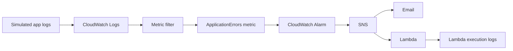

# AWS Application Error Monitoring & Alerting

**A simulated healthcare application-support monitoring lab using Amazon CloudWatch Logs, metric filters, CloudWatch Alarms, SNS, and AWS Lambda.**

## The business problem

In application support environments, recurring errors can be buried in logs until an end user reports a problem. That delays incident detection and makes manual log review a reactive process. In a healthcare operations scenario, examples could include failures to synchronize requests, database connection errors, and API timeouts.

This lab models that problem with **synthetic logs only**. It is an independent learning project, not a production healthcare deployment and does not contain patient data.

## The solution

A CloudWatch Logs metric filter turns matching application log messages into a custom error-count metric. A CloudWatch alarm evaluates that metric over five-minute periods. When the error count exceeds two, SNS sends the alarm notification to a confirmed email address and invokes a Lambda function that logs a structured summary.

**Architecture:** [See diagram and design decisions](docs/architecture.md)



## Technology

AWS CLI v2, Amazon CloudWatch Logs, CloudWatch Metrics and Alarms, Amazon SNS, AWS Lambda (Python 3.13), IAM, Bash, Python unittest.

## Repository structure

```text
.
├── README.md
├── lambda/
│   └── log_processor.py         # SNS alarm event processing
├── scripts/
│   ├── deploy.sh                # Provision or update AWS resources
│   └── send_test_logs.sh        # Publish synthetic application logs
├── tests/
│   ├── lambda_handler_fixture.py
│   └── test_log_processor.py    # Offline unit tests
└── docs/
    ├── architecture.md         # Architecture and tradeoffs
    ├── evidence.md             # Screenshot checklist
    └── screenshots/            # Add real sanitized evidence
```

## Reproduce the lab

Prerequisites: AWS account and permissions to manage Logs, Metrics, Alarms, SNS, IAM, and Lambda; AWS CLI configured with credentials; Python 3 and `zip`; an email address.

```bash
export AWS_REGION=ca-central-1
export NOTIFICATION_EMAIL='you@example.com'
bash scripts/deploy.sh
```

Confirm the subscription email. The script creates/updates the lab resources. IAM may take time to propagate; the script retries initial Lambda creation. Resource names are configurable using `LOG_GROUP_NAME`, `SNS_TOPIC_NAME`, `LAMBDA_FUNCTION_NAME`, `IAM_ROLE_NAME`, `ALARM_NAME`, and `METRIC_FILTER_NAME`. Use separate names for separate environments.

Run unit tests locally:

```bash
python3 -m unittest discover -s tests -v
```

Generate the synthetic log events:

```bash
bash scripts/send_test_logs.sh
```

**Expected monitoring behavior:** four of the five sample messages contain matching error keywords. The filter increments `CustomApp/Monitoring` → `ApplicationErrors`; the alarm watches the Sum over 300 seconds and enters ALARM when it sees more than two matching events in a period. On the ALARM state transition, SNS publishes to email and Lambda. Allow time for metric ingestion and alarm evaluation. If already in ALARM, repeat events may not generate a new transition.

## Verify in AWS

```bash
aws logs describe-metric-filters --log-group-name /aws/application/monitoring-tool
aws cloudwatch describe-alarms --alarm-names log-alarm
aws cloudwatch describe-alarm-history --alarm-name log-alarm --max-records 5
aws sns list-subscriptions-by-topic --topic-arn "$(aws sns list-topics --query "Topics[?contains(TopicArn, 'log-monitoring-alerts')].TopicArn | [0]" --output text)"
aws logs tail /aws/lambda/log-processor --since 1h
```

**Screenshots:** See [evidence checklist](docs/evidence.md). Add genuine screenshots before calling the end-to-end integration verified.

## Design decisions and limitations

- **Keyword filter:** `%ERROR|FAILED|EXCEPTION|TIMEOUT%` is a CloudWatch Logs regex filter for case-sensitive string matches. It replaces the invalid `||` pattern in the reference tutorial. The filter detects text, not incident severity.
- **Alarm:** `Sum > 2` over a single 5-minute period; missing data is treated as not breaching. A notification is generally sent on an alarm state transition, not for each individual log event.
- **SNS:** Fan-out delivers to email and Lambda. Lambda requires a separate resource-based permission allowing this specific topic to invoke it.
- **Lambda:** Parses and records alarm details; it does not yet create tickets or perform remediation.
- **Costs:** AWS charges can apply for logs, metrics, alarms, SNS, and Lambda. Seven-day retention helps bound log storage. Clean up when finished.

## Cleanup

Delete only resources you created for this lab. The scripts default to predictable names; **do not delete an existing shared resource with the same name**. Typical order: CloudWatch alarm → metric filter → SNS topic → Lambda → execution-role policy attachment and role → log group and Lambda execution log group. Verify dependencies and names before deleting anything.

## What I learned

The project demonstrates how a monitoring pipeline connects log ingestion, metric generation, threshold evaluation, event distribution, serverless processing, and IAM permissions. The biggest distinction is that **metric filters read logs, alarms read metrics, SNS distributes alarm events, and Lambda processes SNS notifications**.

## Attribution

Adapted from [mzazon/cloud-projects — Basic Log Monitoring with CloudWatch](https://github.com/mzazon/cloud-projects/blob/main/aws/basic-log-monitoring-cloudwatch/basic-log-monitoring-cloudwatch.md). This repository restructures the lab, changes the filter pattern and Lambda handler packaging, and adds a simulated application-support scenario and tests. The screenshots and real-world deployment evidence must be supplied from your own AWS account.
