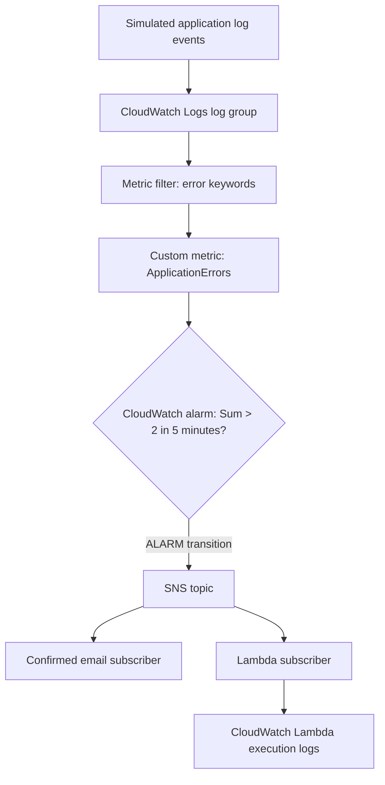

# Architecture and design decisions

**Why a metric filter?** Converts matching log entries into a countable metric. The alarm does not inspect raw logs.

**Why SNS?** Decouples the alarm from one or more destinations: email and Lambda.

**Why Lambda?** Demonstrates event-driven alarm processing. It currently logs structured summaries; it does **not** restart a service, create incidents, or automatically remediate faults.

**Why IAM role and resource policy?** The execution role allows Lambda to write logs after invocation; the resource policy allows this specific SNS topic to invoke Lambda.

**Limitations:** The log source is simulated, the filter matches case-sensitive keywords rather than semantic severity, and one alarm counts all matched categories together. Alarm notifications are emitted on state transitions, not per matching log event. Missing data is configured as non-breaching. Production deployments need richer telemetry, runbooks, deduplication, tested alert routing, and infrastructure as code.
